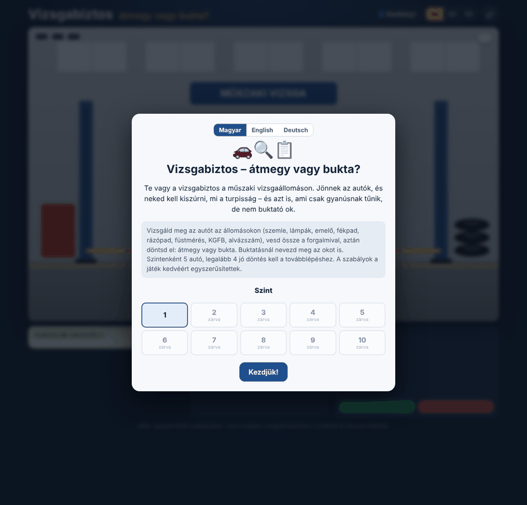
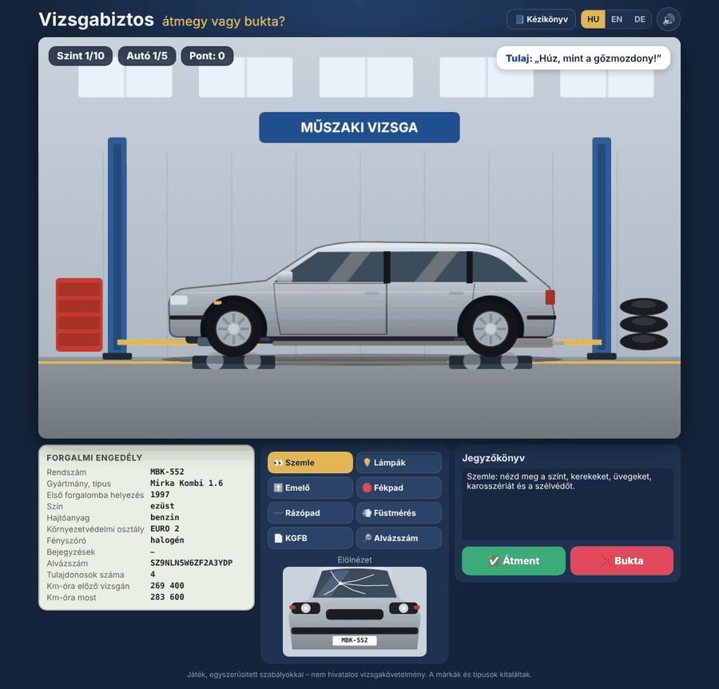
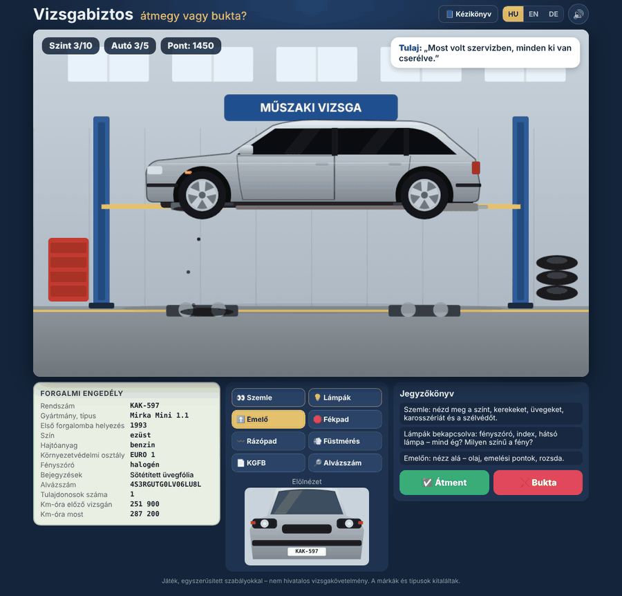
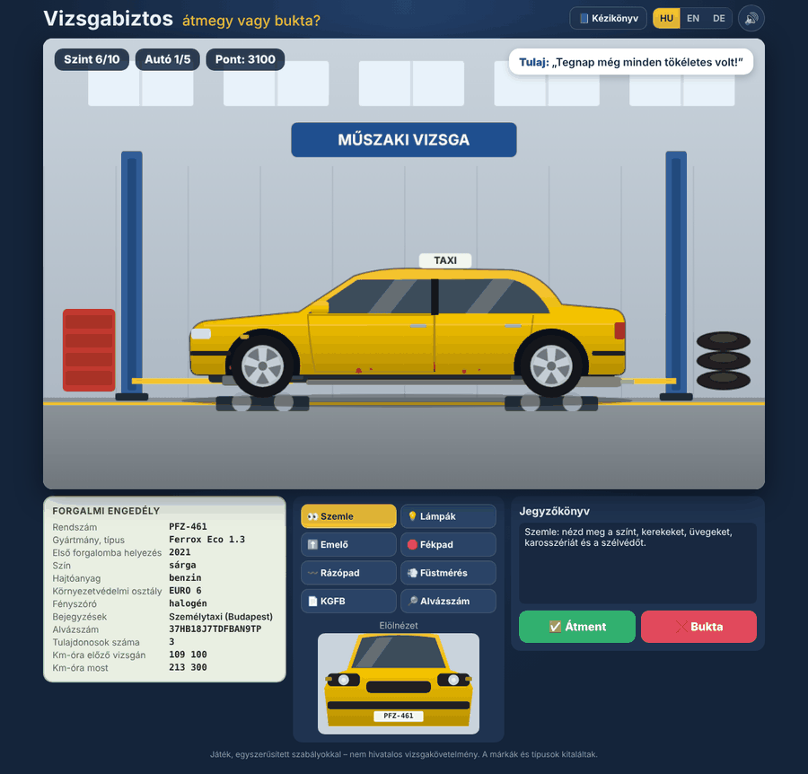
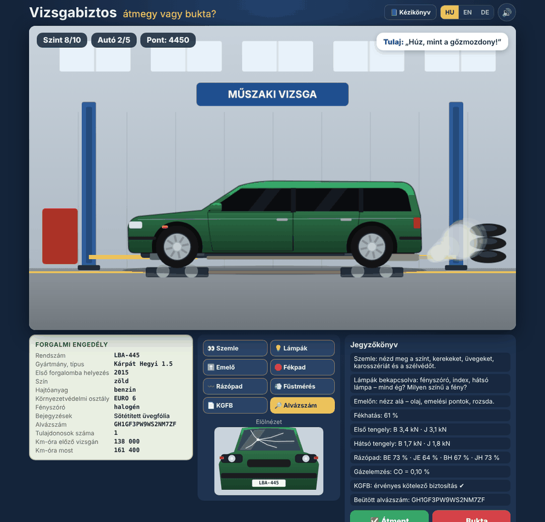
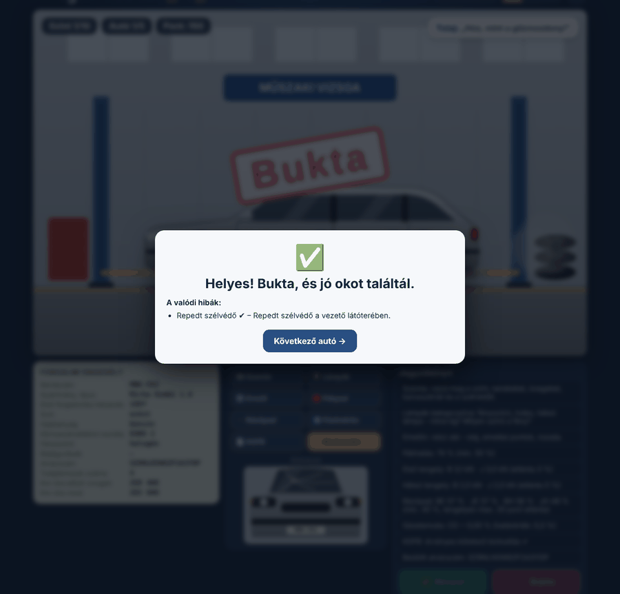
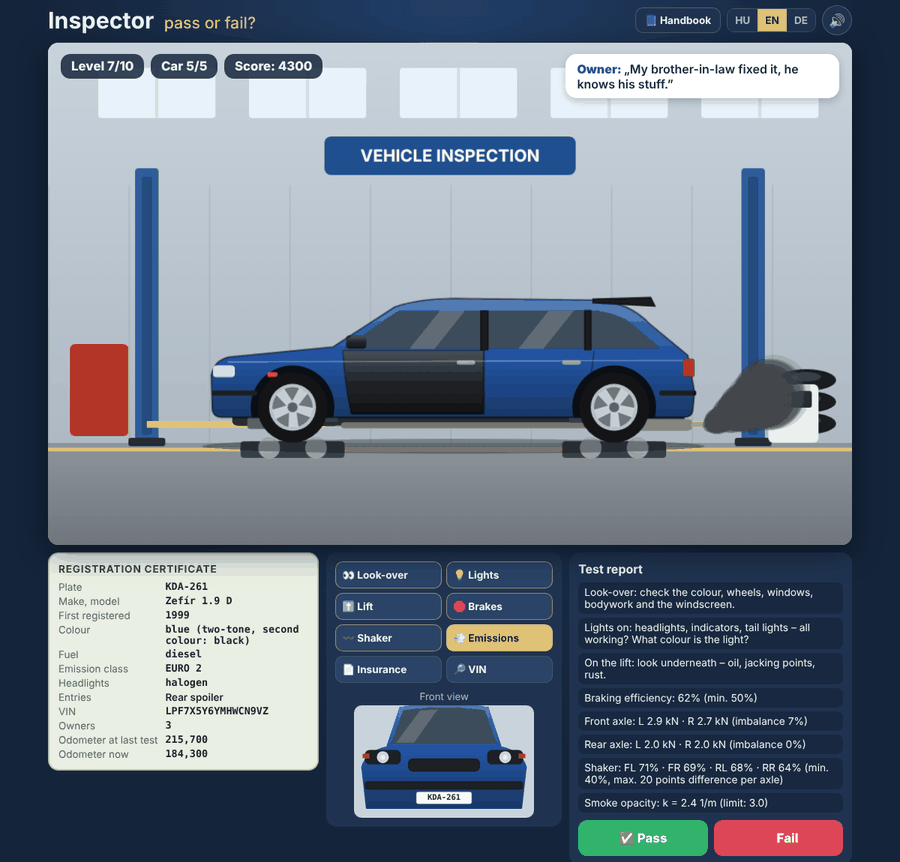
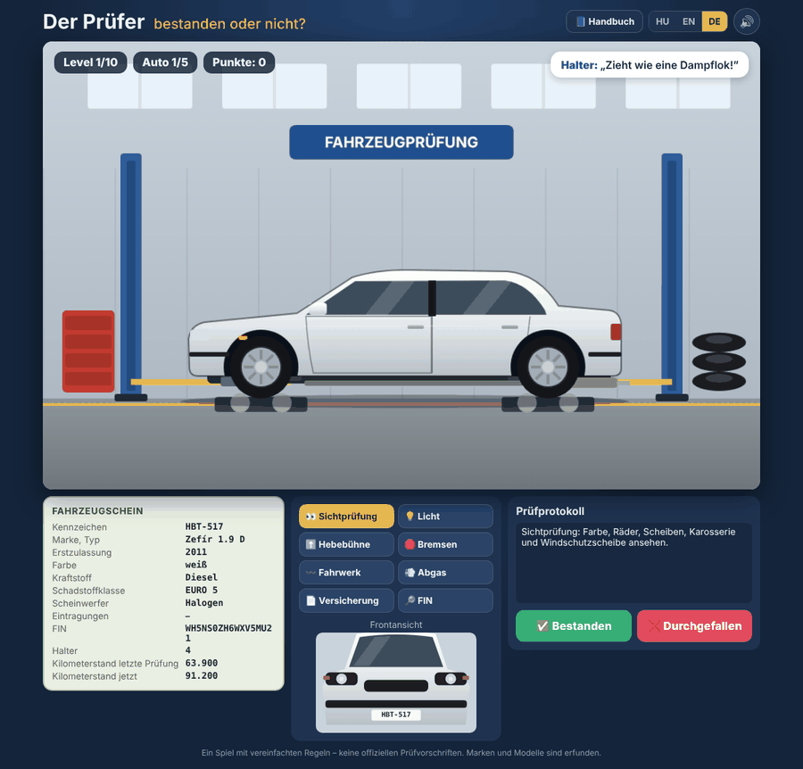

# Vizsgabiztos – átmegy vagy bukta?

### ▶️ [Play it in the browser](https://tibortoth8807.github.io/PassOrFail/)

Böngészős minijáték: te vagy a vizsgabiztos a műszaki vizsgaállomáson. Jönnek az autók, és ki kell szúrnod, mi a turpisság – meg azt is, ami csak gyanúsnak tűnik, de nem buktató ok. 10 szint, magyarul, angolul és németül.



## Menete

- Beáll az autó, mellette a **forgalmi engedély**: szín (kétszínűnél a második is), Euro-osztály, fényszóró típusa, bejegyzések (felni, fólia, szárny, ültetés, taxi), alvázszám, km-óra, tulajdonosok.
- **Állomások:** szemle (elölnézettel), lámpák, emelő, fékpad, rázópad, füstmérés, KGFB-lekérdezés, alvázszám. A mért értékek a jegyzőkönyvbe kerülnek.
- **Döntés:** ✅ Átment vagy ❌ Bukta – buktatásnál meg kell nevezni az okot is. Utána jön a magyarázat: mik voltak a valódi hibák, és mik voltak a csapdák.
- **Szintek:** 5 autó szintenként, legalább 4 jó döntés kell a továbblépéshez. A haladás a böngészőben mentődik.

### Buktató okok

Nem egyező szín, be nem jegyzett más színű elem, be nem jegyzett tuningfelni / sötétítés / szárny / ültetés, repedt szélvédő, nem világító lámpa, LED izzó halogén fényszóróban, füstölés vagy CO a határérték felett, rossz fék a fékpadon, rossz futómű a rázópadon, olajfolyás, átrozsdásodott emelési pont, átrohadt sárvédő, hiányzó biztosítás, eltérő alvázszám – és a budapesti taxiknál: nem sárga, túl öreg (2017 előtt forgalomba helyezettnél 13, utána 10 év), Euro 4 alatti.

### Csapdák (nem buktató okok)

Visszatekert km-óra, sok tulajdonos, bejegyzett átalakítás, felületi rozsda, izzadó (de nem csöpögő) olajteknő, kicsit kormoló régi Euro 1–2-es dízel a határértéken belül, katalizátor nélküli öreg benzines, picit más árnyalatú (javított) ajtó, bejegyzett kétszínű fényezés, gyári LED, 10 évnél idősebb, de 2017 előtt forgalomba helyezett taxi.

### Ahogy nehezedik

Az 1. szinten szembeötlő hibák jönnek (füstfelhő, repedt szélvédő). Később egyre finomabbak lesznek: 48% fékhatás 50% helyett, egyetlen eltérő karakter az alvázszámban, LED izzó a halogénben. A 8. szinttől a fékpad és a rázópad már csak a nyers értékeket mutatja, a határértékeket a 📘 Kézikönyvből kell tudni.

| Repedt szélvédő | Emelőn: olajfolyás |
|---|---|
|  |  |
| **Taxi** | **Jegyzőkönyv a 8. szinten** |
|  |  |
| **Buktató ok kiválasztása** | **Visszajelzés** |
|  |  |
| **English** | **Deutsch** |
|  |  |

## Technika

- TypeScript (strict) + HTML Canvas 2D, Vite – keretrendszer nélkül
- Minden grafika kódból rajzolva (nincs képfájl): egy paraméterezhető autórajz három karosszériával, emelővel, lámpákkal, füsttel
- A szabályok és a szintenkénti autógenerátor DOM-mentes modulban (`src/game/inspection.ts`), seedelhető véletlenszám-generátorral és `node:test` tesztekkel. A tesztek azt is ellenőrzik, hogy a csapdák soha ne okozzanak véletlen hibát, és minden hiba csak a saját szintjétől jelenjen meg.
- Hangok Web Audio API-val, szövegek külön fordítási modulban (`src/i18n.ts`)
- Mind a 10 szint végigjátszva Playwright-tal, három nyelven és mobil nézetben
- GitHub Actions → GitHub Pages deploy

```bash
npm install
npm run dev     # fejlesztői szerver
npm test        # logikai tesztek
npm run build   # dist/
```

## English

A browser mini-game where you are the vehicle inspector at a Hungarian test station. Compare each car with its registration certificate, run it through the stations (lights, lift, brake test, shaker, emissions, insurance, VIN) and decide: pass or fail – and why. Spot the real defects and don't fall for the traps (rolled-back odometer, registered modifications, an old diesel that smokes but is within its limit…). 10 levels, playable in Hungarian, English and German. TypeScript + Canvas 2D, no image files, rules and level generator covered by unit tests.

## Megjegyzés

Játék, egyszerűsített szabályokkal – nem hivatalos vizsgakövetelmény. A márkák és típusok kitaláltak.

MIT licenc.
